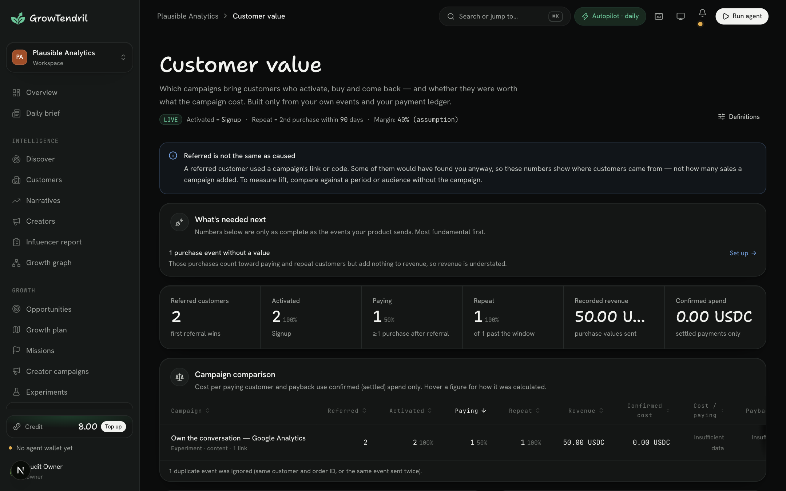

# GrowTendril

  

<strong>Accountable growth operations for internet-native businesses.</strong>

GrowTendril is an AI-assisted growth operator for teams that need a disciplined way to find demand, work with creators, run small experiments, control spending, and learn from verified results. It is designed for local businesses, consumer products, online stores, B2B software, and developer tools.

It turns a fragmented workflow—research in one tool, creator outreach in another, budgets in a spreadsheet, payments in a wallet, and outcomes in analytics—into one reviewable operating loop:

~~~text
Understand the product → discover demand → qualify people and creators → plan an experiment
          → apply a spend policy → approve and pay → measure outcomes → learn
~~~

The guiding principle is simple: **recommendations should be explainable, spending should be bounded, and people should remain accountable for consequential decisions.**

> **Status:** This repository is a private, production-oriented application. Live payment capabilities require explicit Arc mainnet and Circle configuration. The product does not use seeded customer outcomes or simulated production payments.

## Product preview

The customer-value view brings settled spend, tracked activity, referred customers, purchase events, and recommendation logic into one operating view. It is designed to make the next decision clear while preserving the records behind it.

## Contents

- [Why GrowTendril](#why-growtendril)
- [What the product does](#what-the-product-does)
- [How a workspace operates](#how-a-workspace-operates)
- [Creator campaigns and rewards](#creator-campaigns-and-rewards)
- [Measurement and attribution](#measurement-and-attribution)
- [Spend controls and payment safety](#spend-controls-and-payment-safety)
- [Architecture](#architecture)
- [Security model](#security-model)
- [Local development](#local-development)
- [Configuration reference](#configuration-reference)
- [Mainnet operations](#mainnet-operations)
- [Billing and product pricing](#billing-and-product-pricing)
- [Operations reference](#operations-reference)
- [Contributing](#contributing)

## Why GrowTendril

Most teams can name their growth activities, but cannot confidently answer the questions that determine whether to keep funding them:

- Which market conversations show real demand for our product?
- Which people or companies are worth contacting now?
- Which creators have genuine topical relevance instead of only a large audience?
- What did an experiment cost, what happened afterward, and what should change next?
- Can we pay for work without giving an automated system open-ended access to a budget?

GrowTendril is built to make each answer inspectable. It retains source links for discovery, displays score rationale, evaluates payment rules deterministically, records money movement, and separates observed referral from unproven causal claims.

## What the product does

### 1. Builds an editable product and market profile

Start with a website and a short description of the business. GrowTendril reads public product pages and creates an editable profile that describes:

- what the product does;
- the intended customer and likely buying context;
- positioning, category language, and relevant problems;
- public competitor and market context;
- location signals where they can be established from the site.

The profile gives discovery and planning work a business-specific context. The system avoids adding unverified competitors merely to make a list look complete.

### 2. Finds source-linked demand signals

GrowTendril reads configured public sources for customer and company signals such as recommendation requests, product launches, hiring activity, category complaints, alternative comparisons, and relevant technical discussions.

Supported sources include Bluesky, Hacker News, Reddit, GitHub, YouTube, RSS feeds, and X when the related credentials or access are configured. Every surfaced signal remains linked to its source so a team can examine the original context before acting.

### 3. Qualifies creators by contribution quality

Creator discovery is designed to find people already adding value to the relevant conversation. Scores weigh topical relevance and recent activity, discussion and engagement quality, audience and product fit, historical category coverage, and authenticity signals.

Follower count makes only a limited contribution. Accounts that look automated, post links with suspicious regularity, show anomalous engagement patterns, or identify themselves as bots are capped in both authenticity and overall scoring. Publishing frequently alone is not enough to appear credible.

### 4. Proposes bounded experiments

The operator can turn opportunities into structured experiments with a hypothesis, target, budget, timeframe, tracked link, success event, and stop condition. Teams can inspect the proposal, change it, run it, or decline it.

The product drafts research, campaign material, and outreach ideas. It does not contact people on a workspace's behalf.

### 5. Connects spending to measurable work

Creator payouts, research purchases, and other payment proposals pass through a deterministic policy engine before money can move. Payments are tied to a named recipient and a recorded reason. Approvals, decisions, state changes, receipts, transaction hashes, and reconciliation exceptions are retained for review.

### 6. Measures customer value

Tracked links, signed conversion events, manually recorded conversions, and settled payment records feed the customer-value view. It can show activated customers, paying customers, repeat activity, confirmed spend, cost per paying customer, and estimated payback when margin data is supplied.

Referral attribution describes where a customer came from. It does not assert that an experiment caused a purchase without sufficient evidence.

## How a workspace operates

| Stage | What happens | Evidence retained |
| --- | --- | --- |
| **Onboard** | A team supplies its website, customer context, mission, budget, and operating rules. | Product profile, mission, workspace policy |
| **Discover** | Connected sources are read for demand, company, narrative, and creator signals. | Source URLs, captured context, score rationale |
| **Plan** | The operator proposes experiments and creator work against the mission. | Hypothesis, budget, timeframe, stop condition |
| **Review** | The team edits or accepts work and decides which payment actions require approval. | Role-based action trail, policy result |
| **Execute** | Approved work runs through the job queue; payments use the workspace's Arc wallet. | Payment state trail, Circle reference, Arc transaction hash |
| **Measure** | Links and signed first-party events connect activity to outcomes. | Attribution records, settled spend, customer-value report |
| **Learn** | Deterministic rules recommend whether to continue, reduce, stop, or scale a tested path. | Recorded inputs, outcome rationale, recommendation |

### Workspace roles

Teams can invite members by email and assign workspace roles. Permissions are checked at the mutation boundary, not only in the interface. Owners and administrators can manage policy and members; more limited roles can collaborate without receiving unrestricted access to money controls.

The outbound-notification area has its own manage_integrations permission. This keeps the ability to send data to third-party endpoints separate from routine workspace participation.

## Creator campaigns and rewards

Creator campaigns turn creator discovery into a controlled engagement flow:

1. A business defines the campaign brief, platform, objective, available slots, budget, and reward structure.
2. The business sends a private invitation to a shortlisted creator.
3. The creator accepts the terms, supplies a payout address, and submits an ownership proof.
4. The workspace verifies the creator, then reviews their submitted work.
5. GrowTendril calculates the proposed reward from the published campaign rules and verified results.
6. The workspace approves the payment before it is sent.

A reward can include:

| Component | Purpose |
| --- | --- |
| **Base payment** | Compensation for accepted work. |
| **Quality bonus** | Recognition for useful, original, and well-executed content. |
| **Outcome bonus** | Additional reward for verified customer actions within the defined campaign window. |

This structure aims to reward contribution quality and measured value instead of treating raw follower count or post volume as the sole signal of worth.

## Measurement and attribution

GrowTendril favors first-party, inspectable measurement:

- **Tracked links** capture campaign visits automatically.
- **Signed conversion events** allow a website or application to report events such as signup and purchase.
- **Manual conversion records** support workflows that cannot send events automatically.
- **Settled-spend records** distinguish a proposed or submitted payment from one confirmed on Arc.
- **Customer-value reporting** joins attributed outcomes to confirmed spend.

### Sending conversion events

The workspace's **Integrations → Inbound events** area provides a signed endpoint. Send the visitor's stable internal ID as visitorId; include value for purchases where revenue is known. Event handling verifies an HMAC signature on the raw body, uses a five-minute replay window, and is idempotent on the supplied event key.

The detailed product workflow is available in [docs/USER_GUIDE.md](docs/USER_GUIDE.md).

## Spend controls and payment safety

GrowTendril deliberately separates intelligence, proposals, approvals, and settlement. A model can help draft language or interpret product material; it does not receive authority to spend funds.

### Policy decisions

Every payment proposal is evaluated by code and produces one of three outcomes:

| Result | Meaning |
| --- | --- |
| **ALLOW** | The action fits the active policy and may proceed. |
| **APPROVAL REQUIRED** | A person must review and explicitly approve the action. |
| **DENY** | The action cannot proceed because a hard rule is violated. |

The policy takes account of recipient provenance, category and mission budgets, daily spending limits, autonomy limits, payment history, and the current workspace wallet state.

### Hard launch protections

- **10 USDC maximum per payment:** the application enforces this launch ceiling in code.
- **Arc mainnet only for live spending:** cross-chain transfers are disabled.
- **Named, reviewable recipients:** payments require a recorded recipient and purpose.
- **Approval by default:** creator payouts always require explicit review.
- **Wallet freeze:** a workspace can stop spending immediately through its wallet controls.
- **Execution-time checks:** hard rules are evaluated again when a payment is executed.
- **Chain confirmation:** a payment is settled only after Arc confirms the approved amount at the approved recipient.
- **Reconciliation:** independent jobs compare wallet outflows with recorded payment data and surface discrepancies.

### Arc and Circle

Live workspace wallets use Circle developer-controlled wallets on Arc mainnet. Circle manages the wallet keys; GrowTendril uses server-side Circle credentials for approved operations. The application rejects test Circle keys, malformed keys, non-Arc wallets, and wallets that are not configured for Circle live mode.

For eligible paid data requests, GrowTendril can authorize Circle Gateway x402 payments. It evaluates policy against the quoted amount, then protects the execution path against a higher amount than the approved quote.

## Outbound notifications

Workspace admins can configure Slack, Discord, or a signed JSON webhook for:

- approval requests;
- payment settlement or failure;
- operator-cycle completion;
- creator-work submissions.

Endpoints must use HTTPS and pass the public-network guard. Endpoint credentials are encrypted at rest. Delivery is queued, deduplicated by endpoint and event, retried up to six times, and recorded with the delivery status. JSON endpoints receive an x-growtendril-signature header for HMAC verification.

## Architecture

| Layer | Implementation | Responsibility |
| --- | --- | --- |
| Web application | Next.js 15, React 19, TypeScript | Product UI, server actions, authenticated app routes |
| Persistence | Drizzle ORM; Postgres in production, PGlite locally | Workspace data, audit trail, durable jobs, money records |
| Intelligence | Gemini or Anthropic with deterministic fallbacks | Product analysis, drafting, synthesis |
| Discovery | Provider adapters for public sources | Source-linked market and creator signals |
| Jobs | Durable database queue with leasing, deduplication, and retries | Operator cycles, settlements, reconciliation, notifications |
| Custody and payments | Circle developer-controlled wallets, Arc USDC, Circle Gateway x402 | Approved wallet actions and paid data requests |
| Authentication | Email/password or Google OAuth; signed sessions | Identity, email verification, workspace membership |
| Deployment | Railway-compatible Node.js service | Production delivery and environment configuration |

## Security model

The repository includes tests for authentication boundaries, workspace isolation, policy behavior, money controls, billing claims, inbound and outbound webhook protections, public-network restrictions, and reconciliation-related flows.

| Control | How it is implemented |
| --- | --- |
| Secret handling | Server-only environment variables; no secrets use a NEXT_PUBLIC_ prefix. |
| Encryption at rest | Provider credentials and outbound-webhook secrets use AES-256-GCM. |
| Network egress protection | User-supplied websites, feeds, and notification endpoints are checked for private addresses, localhost, embedded credentials, unsafe redirects, and DNS rebinding. |
| Payment integrity | Conditional state transitions, idempotency keys, transaction-event records, execution-time policy checks, and chain confirmation reduce duplicate or mismatched execution. |
| Webhook integrity | Inbound conversion events use HMAC verification, replay protection, and idempotency. Outbound JSON webhooks are HMAC signed. |
| Auditability | Member, policy, wallet, payment, and integration activity is recorded in a workspace-scoped trail. |
| Mainnet separation | Historical testnet records are retained for receipts but cannot sign Arc mainnet payments. |
| Operational checks | npm run doctor is read-only and never creates wallets, moves funds, or prints secrets. |

## Local development

### Prerequisites

- Node.js 22 or newer
- npm
- Postgres for production environments
- A Circle developer-controlled-wallet account only when testing live payment operations

PGlite is selected automatically when DATABASE_URL is absent, making a database available for local development without a separate server.

### Start the application

~~~bash
npm ci
cp .env.example .env
npm run dev
~~~

Open [http://localhost:3000](http://localhost:3000), create an account, and complete onboarding. With no DATABASE_URL, local data is stored in .data/pglite. Drizzle migrations are applied at startup.

.env contains deployable configuration. Use .env.local for machine-specific overrides. Neither file should be committed.

### Isolated UI testing

Do not test payment, email, or integration flows with production credentials present. The following starts an isolated development server with a throwaway PGlite directory and blanked live credentials:

~~~bash
env NEXT_DIST_DIR=.next-audit PGLITE_DIR=/tmp/gt-audit-db DATABASE_URL= RESEND_API_KEY= EMAIL_FROM= CIRCLE_API_KEY= CIRCLE_ENTITY_SECRET= GOOGLE_CLIENT_ID= GOOGLE_CLIENT_SECRET= ONRAMP_API_KEY= BILLING_ARC_ADDRESS= BILLING_DEV=1 GROWTHOS_WORKER=off npx next dev -p 3100
~~~

When email is not configured locally, verification codes are written to the server console.

### Verification commands

| Command | Purpose |
| --- | --- |
| npm run dev | Start the local development server on port 3000. |
| npm run build | Create a production build. |
| npm run start | Start the production server. |
| npm run typecheck | Run TypeScript without emitting files. |
| npm test | Run the Vitest suite. |
| npm run worker | Run the standalone durable-job worker. |
| npm run doctor | Run read-only Circle and Arc money-path checks. |
| npm run circle:entity-secret | Register or recover the Circle entity-secret setup. |
| npm run env:push -- --dry-run | Validate production configuration without uploading it. |
| npm run env:push | Upload configured environment values and redeploy through Railway. |
| npm run ledger:exceptions | List ledger records that require reconciliation review. |
| npm run signals | Start the optional standalone paid data service. |

Before a release, run:

~~~bash
npm run typecheck
npm test
NEXT_DIST_DIR=.next-build npx next build
~~~

CI runs dependency installation, type checking, tests, and a production build for pushes to main.

## Configuration reference

Copy .env.example to .env and configure only the services the deployment uses. Never commit environment files, Circle recovery material, private keys, database exports, or generated local data.

### Required in production

| Variable | Purpose |
| --- | --- |
| DATABASE_URL | Production Postgres connection string. |
| APP_URL | Public application URL, such as https://growtendril.xyz. |
| SESSION_SECRET | Secret used to sign sessions; use at least 32 characters. |
| ENCRYPTION_KEY | A 32-byte AES key encoded as 64 hexadecimal characters or base64. |

### Identity and communications

| Variable | Purpose |
| --- | --- |
| RESEND_API_KEY, EMAIL_FROM | Verified email delivery for codes, receipts, reports, and invitations. |
| GOOGLE_CLIENT_ID, GOOGLE_CLIENT_SECRET | Google OAuth; callback URL: <APP_URL>/api/auth/google/callback. |
| OPERATOR_EMAIL | Destination for alerts about unmatched billing payments. |

### Arc and Circle

| Variable | Purpose |
| --- | --- |
| CIRCLE_API_KEY | Complete production LIVE_API_KEY for Circle developer-controlled wallets. |
| CIRCLE_ENTITY_SECRET | Entity secret registered to the Circle account. |
| BILLING_ARC_ADDRESS | Arc address that receives prepaid-credit top-ups. |
| ARC_MAINNET_RPC | Optional Arc RPC endpoint override. |
| GATEWAY_API_URL | Optional Circle Gateway API override. |

### Intelligence and source providers

Set GEMINI_API_KEY or ANTHROPIC_API_KEY to enable AI-generated analysis and writing. LLM_PROVIDER=claude or LLM_PROVIDER=gemini chooses a provider explicitly.

Optional source integrations include X, YouTube, Reddit, RSS, GitHub, and onramp support. Their configuration variables and usage notes are documented in [.env.example](.env.example).

### Development billing

Set BILLING_DEV=1 only on a local machine and only when BILLING_ARC_ADDRESS is empty. It enables a free local-credit stand-in for exercising paid-service flows.

## Mainnet operations

Live payments require a deliberate operating process. Do not use local or test credentials in production.

1. Back up the production database and place Circle entity-secret recovery material outside the repository and development machine.
2. Configure DATABASE_URL, APP_URL, SESSION_SECRET, and ENCRYPTION_KEY in the production service.
3. Add a Circle production LIVE_API_KEY, then run npm run circle:entity-secret once. If Circle reports an existing secret, recover and use the current CIRCLE_ENTITY_SECRET; do not replace it with a new secret.
4. Run npm run env:push -- --dry-run, then npm run doctor. These are read-only validation steps.
5. Create or attach a Circle developer-controlled **EOA** wallet on **Arc mainnet** for the workspace.
6. Fund that wallet with Arc mainnet USDC. Deposit into Circle Gateway only when the workspace needs paid x402 services.
7. Connect intended market sources, set a mission and spend policy, and begin with small founder-approved payments.

npm run doctor checks Circle-key environment shape, entity-secret format, Circle API and public-key access, wallet-set access, Arc RPC availability, and—when a production database is configured—the current Arc wallet and Gateway balances. It does not create a wallet, transfer funds, or reveal secret values.

## Billing and product pricing

GrowTendril uses prepaid USDC credit on Arc rather than a recurring subscription. A workspace owner tops up credit, and paid services deduct from that balance only when the work runs. A failed paid-service attempt is refunded automatically.

The billing address is operated by GrowTendril. The application observes Arc transfers to confirm a top-up; it does not custody the customer's wallet.

| Service | Price | What it includes |
| --- | --- | --- |
| Market scan | 2 USDC per scan | An operator cycle that reads sources, scores opportunities and creators, updates the growth plan, and proposes experiments. Each autopilot run is one scan. |
| Influencer report | 3 USDC per refresh | Creator scouting, profile review, contact routes, and initial outreach ideas. |
| Campaign brief | 2 USDC per rewrite | A refreshed brief for one creator. The first draft for each creator is free. |

Browsing, workspace settings, team management, and exports are free. Top-ups start at 2 USDC. If an autopilot run is due while the balance is too low, it waits rather than charging or executing a paid cycle.

> **Two balances, two purposes:** prepaid credit pays for GrowTendril services. The workspace wallet funds approved experiment and creator payments. Keep these balances distinct when operating the product.

## Operations reference

### Health

GET /api/health reports non-sensitive readiness for custody, email, billing, Google OAuth, and the selected AI provider. Use it after deployment to verify service configuration without exposing credentials.

### Background work

The application uses a durable database queue for operator cycles, settlement checks, Gateway deposit work, billing checks, wallet reconciliation, cleanup, and outbound-webhook delivery. Run npm run worker when deploying the worker separately from the web process. In environments without a persistent worker, the cron-cycle endpoint can schedule due autopilot work and drain queued jobs.

### Deployment checklist

- Confirm the working tree is clean and the full verification suite passes.
- Ensure database migrations are additive and a production backup exists.
- Validate production configuration with npm run env:push -- --dry-run and npm run doctor.
- Confirm /api/health and application logs are clean after release.
- Start with a funded workspace, a small mission budget, and approvals required for payments.
- Review npm run ledger:exceptions regularly while operating live money paths.

## Repository guide

| Path | Description |
| --- | --- |
| [src/app](src/app) | Next.js pages, route handlers, and authenticated product UI. |
| [src/server/domain](src/server/domain) | Core business rules for intelligence, policy, billing, payments, attribution, and notifications. |
| [src/server/integrations](src/server/integrations) | Circle, AI, source-provider, email, and vault adapters. |
| [src/server/jobs](src/server/jobs) | Durable queue, scheduling, and job handlers. |
| [drizzle](drizzle) | Versioned database migrations and schema metadata. |
| [tests](tests) | Automated coverage for product, security, financial, and integration behavior. |
| [docs/USER_GUIDE.md](docs/USER_GUIDE.md) | Step-by-step guide for workspace operators. |
| [docs/PLAN.md](docs/PLAN.md) | Product and delivery planning material. |

## Contributing

Contributions should be focused, reviewable, and backed by meaningful verification.

1. Create a branch with a clear scope.
2. Keep environment values, keys, recovery files, database dumps, and generated local data out of commits.
3. Add or update tests when behavior changes.
4. Run type checking, the test suite, and a production build before requesting review.
5. Preserve compatibility for live tracking links, webhook headers, and payment records unless the change includes a documented migration path.

## License

This repository is private and does not grant a public software license. Contact the project owner before reuse, redistribution, or deployment of this code.
