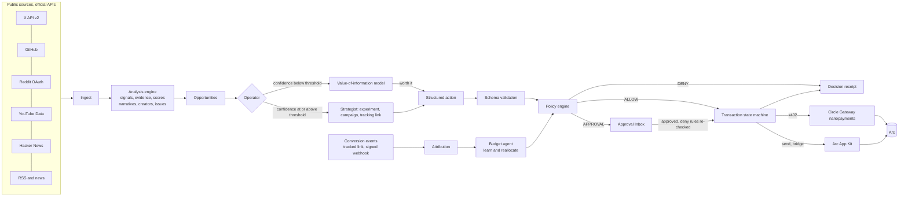

<div align="center">

# GrowTendril

**An autonomous growth operator for any business.**<br/>
Give it a product, a goal and a budget. It finds who is ready to buy, decides what is worth doing, pays for it within rules you set, and proves what worked.

[](https://github.com/drained69/GrowTendril/actions/workflows/ci.yml)


</div>

```
DISCOVER → UNDERSTAND → VERIFY → DECIDE → SPEND → EXECUTE → MEASURE → ATTRIBUTE → LEARN → REALLOCATE → repeat
```

GrowTendril optimizes one number: **verified growth per dollar spent.** It does not optimize followers, impressions, posts or emails sent, and it never contacts anyone on your behalf.

---

## Contents

1. [Who it is for](#who-it-is-for)
2. [What it does](#what-it-does)
3. [Quick start](#quick-start)
4. [A worked example](#a-worked-example)
5. [Core concepts](#core-concepts)
6. [How the intelligence works](#how-the-intelligence-works)
7. [Creator campaigns](#creator-campaigns)
8. [Measuring results](#measuring-results)
9. [The policy engine](#the-policy-engine)
10. [Payments on Circle and Arc](#payments-on-circle-and-arc)
11. [Architecture](#architecture)
12. [Configuration](#configuration)
13. [Deployment](#deployment)
14. [Testnet and mainnet](#testnet-and-mainnet)
15. [Security and privacy](#security-and-privacy)
16. [Verification and testing](#verification-and-testing)
17. [Troubleshooting](#troubleshooting)
18. [Known limitations](#known-limitations)
19. [Roadmap](#roadmap)
20. [Contributing](#contributing)

---

## Who it is for

GrowTendril is for **any business that has a product and wants customers**, from a one-person shop to a funded startup. It is not specific to crypto or software. The engine looks for _buying intent in public conversation_: people asking for recommendations, comparing options, complaining about alternatives, switching tools, or announcing something that creates a need. Those signals exist in every market.

| If you sell…                         | Signals it looks for                                                                                | A typical goal                  | Sources that help most               |
| ------------------------------------ | --------------------------------------------------------------------------------------------------- | ------------------------------- | ------------------------------------ |
| **SaaS and B2B software**            | Recommendation requests, migrations away from a competitor, hiring for the role your product serves | Signups, demo requests, trials  | Reddit, X, YouTube, Hacker News, RSS |
| **E-commerce and consumer products** | "Any good \_\_\_?" threads, gift searches, complaints about alternatives, review discussions        | Purchases                       | Reddit, YouTube, X                   |
| **Local services and marketplaces**  | "Looking for a \_\_\_" posts, questions, service complaints                                         | Bookings, leads                 | Reddit, X, RSS                       |
| **Education and communities**        | Learners comparing courses, questions about getting started                                         | Signups, trials, purchases      | YouTube, Reddit, X, RSS              |
| **Health and wellness**              | Habit and routine discussions, product comparisons                                                  | Trials, app installs, purchases | YouTube, Reddit                      |
| **Finance and fintech**              | Questions about tools, switching providers, pain points                                             | Signups, qualified leads        | Reddit, X, RSS                       |
| **Developer tools**                  | Public technical questions, adoption of rival tools, repo activity                                  | SDK keys, installs              | GitHub, Hacker News, Reddit, X       |
| **Web3 and crypto products**         | Integration questions, launches, wallet and chain discussions                                       | Wallet connects, signups        | X, GitHub, Hacker News, Reddit       |

> **Be realistic about fit.** GrowTendril works best where your buyers talk in public (forums, social platforms, video comments, blogs). If your customers are found only through private channels, there is less to observe. Signal detection currently reads English-language text.

You do not need to know anything about crypto to use it. Payments are made in **USDC**, a US-dollar stablecoin: you fund the agent's wallet once, and it pays for data and creators from that budget under your limits. See [Payments on Circle and Arc](#payments-on-circle-and-arc) for what that means in practice.

## What it does

**Understand your market**

- Reads your public site and docs to build a product profile and ideal customer profile (ICP).
- Collects public posts from the sources you connect and turns them into dated, attributable **evidence**.
- Scores companies and people on buying intent with a transparent, weighted breakdown, and shows _why now_.
- Maps **narratives** (the topics people are talking about), their velocity and lifecycle, and which voices drive them.
- Detects **product issues** in public feedback and holds paid acquisition while one is blocking sign-ups.

**Decide what is worth doing**

- Ranks **creators** (influencers, writers, channel owners) by relevance and discussion quality, not follower count.
- Turns high-confidence opportunities into **experiments** with a hypothesis, a success metric and a stop condition.
- Decides whether extra information is worth buying, using an expected-value model, and buys it automatically when it is.

**Spend safely**

- Every payment is a structured action checked by a deterministic **policy engine**: limits, categories, approvals, a kill switch.
- Anything above your limits waits in an **Approval Inbox**. Approvals re-check the hard rules.
- Every decision produces a sha256-sealed **receipt** that links to the payment trace.

**Prove what worked**

- First-party **attribution**: tracked links and signed conversion events tie each result to the experiment that produced it.
- Measures cost per qualified conversion, stops losing experiments and moves unspent budget to winners.
- **Creator campaigns** let creators opt in, publish under rules they can read first, and earn per accepted post and verified result.

**Run it as a team product**

- Workspaces with roles, invites, encrypted per-workspace integrations and an isolated wallet per workspace.
- Autopilot on a schedule, a durable job queue, a daily brief and a full audit trail.

### The principles it is built on

- **Money moves only through code, never through a prompt.** An AI model never sets a score, never computes attribution and never triggers a payment.
- **No spam.** It produces opportunities, evidence and drafts. A human decides who to contact.
- **No fabrication.** Every record is labelled `DEMO`, `SIMULATED`, `TESTNET` or `LIVE`. There are no invented posts, hashes, settlements or metrics.
- **Honest numbers.** Budget figures say where they came from: measured from your data, your setting, or a starting value you have not reviewed. Missing inputs stay missing.

---

## Quick start

Requires **Node 20 or newer**. No API keys are needed to explore.

```bash
git clone https://github.com/drained69/GrowTendril.git
cd GrowTendril
npm install
cp .env.example .env.local
npm run dev                               # web on :3000, sample data seller on :4021
```

Open <http://localhost:3000> and choose **See it work**. This creates a private guest workspace with a fictional product (labelled `DEMO` everywhere) so you can explore every screen. Payments in the demo are recorded as **SIMULATED**: the full decision and policy path runs and nothing moves.

### Use it for your own product

1. **Sign up** and create a workspace. Enter your site, docs link and a short description.
2. **Review** the generated profile and ideal customer, then pick a **mission** (for example _First 100 Customers_), a goal, a timeframe and a budget.
3. **Set your limits** and an autopilot cadence, or leave autopilot off and run cycles by hand.
4. **Connect sources** under _Integrations_ (Hacker News works with no key; Reddit, YouTube, X, GitHub and RSS take keys).
5. **Run a scan.** It collects and analyzes evidence only and never spends.
6. Optional, when you want it to act: create the **agent wallet**, fund it, and send **conversion events** from your product so results can be attributed. See [Testnet and mainnet](#testnet-and-mainnet).

### Scripts

| Command                          | What it does                                                                                         |
| -------------------------------- | ---------------------------------------------------------------------------------------------------- |
| `npm run dev`                    | Web app plus the sample x402 data seller                                                             |
| `npm run dev:web`                | Web app only                                                                                         |
| `npm run build` then `npm start` | Production build and server                                                                          |
| `npm test`                       | Unit and integration tests (63)                                                                      |
| `npm run typecheck`              | `tsc --noEmit`                                                                                       |
| `npm run demo:run`               | Run the 8-step demo loop headlessly, in simulation                                                   |
| `npm run doctor`                 | Validate the payment integration against the real network, step by step                              |
| `npm run wallet:setup`           | `-- --entity-secret` registers a Circle entity secret; `-- --local` prints a throwaway testnet key   |
| `npm run worker`                 | Standalone job worker (see [Deployment](#deployment))                                                |
| `npm run signals`                | The sample x402 data seller on its own                                                               |
| `npm run db:seed`                | Reset and seed the demo workspace                                                                    |
| `npm run db:generate`            | Generate a migration after a schema change                                                           |
| `npm run test:events`            | Send valid, replayed and tampered signed events to a running instance (uses the seeded demo project) |

> The embedded database (PGlite) is single-process. Stop the dev server before running `db:seed` or `demo:run` against the same `.data/pglite` folder, or point `PGLITE_DIR` elsewhere. Set `DATABASE_URL` to use Postgres.

---

## A worked example

_Illustrative. The bundled demo uses a fictional developer tool; this shows how the same loop applies to a different business._

**Hearth & Wick** sells hand-poured soy candles online. The owner has 400 USDC to test growth and wants 100 paying customers.

1. **Onboarding.** She enters the shop URL. GrowTendril reads the public pages and classifies the product as _E-commerce and consumer products_, with target users such as gift buyers and brand-loyal customers. She edits the competitors it could not know.
2. **Mission.** _First 100 Customers_, goal event `purchase`, 30 days, 400 USDC.
3. **Economics.** In _Settings → Economics_ she enters what a customer is worth (40 USDC) and her margin (60%). Until her store has sent enough purchase events, the action-to-customer rate is shown as **No data** and the planner will not invent one.
4. **Integrations.** She connects Reddit and YouTube. A scan finds public threads such as _"any recommendations for a non-toxic soy candle?"_, tagged as recommendation requests, with the thread linked as evidence.
5. **Opportunities.** GrowTendril surfaces a narrative ("clean-burning candles") that is accelerating, and three creators who write thoughtful gift guides, ranked above a larger account whose engagement looks inflated.
6. **Creator campaign.** She sets _Purchase_ as the target, a max cost per purchase of 12 USDC and a 200 USDC test budget. The plan explains the number of creators, base pay per accepted post, the per-action bonus and the holdback. Only the test phase is released at launch.
7. **Creators opt in** through a public link, read the rules (including the disclosure requirement) and apply. She accepts three. Each gets a private tracking link.
8. **Posts and results.** Creators submit their posts. She reviews them against a rubric and cannot accept one that lacks a clear disclosure. Her shop's checkout sends a signed `purchase` event carrying the tracking reference, so each sale is credited to the right creator.
9. **Payouts.** Earned rewards, after the holdback, become payouts. Each goes through the policy engine and, because creator payments are approval-gated by default, waits in her Approval Inbox with the reason for every line.
10. **Learning.** The held budget goes only to creators whose measured cost per purchase beats her ceiling. A daily brief summarizes spend, results and what changed.

---

## Core concepts

| Concept         | Meaning                                                                                                                                                                           |
| --------------- | --------------------------------------------------------------------------------------------------------------------------------------------------------------------------------- |
| **Workspace**   | One product being grown. Everything is scoped to a workspace: data, wallet, integrations, members, policy.                                                                        |
| **Mission**     | A goal (a conversion event and a target), a timeframe and a budget split by category.                                                                                             |
| **Opportunity** | Something worth doing about a company, a creator, a narrative or a customer, with a confidence score and the evidence behind it.                                                  |
| **Experiment**  | A measurable bet with a hypothesis, success metric, stop condition and a budget paid in two tranches.                                                                             |
| **Evidence**    | A dated, sourced observation. Purchased evidence is tagged `PAID · x402`.                                                                                                         |
| **Policy**      | Your spending rules, enforced in code on every action.                                                                                                                            |
| **Receipt**     | A sha256-sealed record of what the agent saw, why it acted, the policy verdict and the payment trace.                                                                             |
| **Data mode**   | `DEMO` (fictional seed data), `SIMULATED` (would have happened, nothing moved), `TESTNET` (real activity with test funds) or `LIVE` (real public data, or real funds on mainnet). |

### Roles

| Role       | Can                                                                                                                           |
| ---------- | ----------------------------------------------------------------------------------------------------------------------------- |
| **Viewer** | Read intelligence, experiments and receipts                                                                                   |
| **Member** | Everything a viewer can, plus run scans and cycles, create experiments and campaigns, and review posts                        |
| **Admin**  | Everything a member can, plus approve spend, edit the spend policy and economics, manage the wallet, integrations and members |
| **Owner**  | Everything an admin can, plus workspace settings and deletion; on mainnet, only an owner can resume a frozen wallet           |

Permissions are checked in every server action and page. Invites are single-use links whose token is stored hashed and expires after seven days.

### Screens

Overview, Daily brief, Discover, Customers, Narratives, Creators, Growth graph, Opportunities, Missions, Creator campaigns, Experiments, Wallet, Approvals, Arc / Circle activity, Receipts, Agent runs, Integrations, Team and Settings (workspace, product profile, ideal customer, spend policy, economics, autopilot). A ⌘K command palette jumps anywhere.

### Scans, cycles and autopilot

- **Run scan** collects and analyzes evidence. It never buys data, creates experiments or pays anyone.
- **Run cycle** runs the full loop and _may spend within your policy_: buy verifying data, propose an experiment's first payment, reallocate budget.
- **Autopilot** (hourly, every 6 hours or daily) schedules cycles for live workspaces. Every run and its step-by-step log appears under _Agent runs_.

---

## How the intelligence works

Everything below is deterministic code. Claude is optional and only used for reading your product pages and drafting creator briefs; it never scores, attributes or pays.

### Customer discovery

Posts are classified with auditable rules into intent signals: **recommendation requests, competitor usage, migrations, complaints, questions, launches, new initiatives, funding, hiring, partnerships and adoption**. Organizations are attributed only when the source states it (for example an org-owned repository or a launch post); nothing is guessed from a name.

Each company gets a score from 0 to 100 with a reason for every component:

| Component              | Weight | How it is measured                                               |
| ---------------------- | ------ | ---------------------------------------------------------------- |
| Product fit            | 0.25   | Overlap with your product keywords and ICP segments              |
| Timing                 | 0.20   | Recency of the top three signals, with a 7-day half-life         |
| Buying intent          | 0.25   | Noisy-OR over the strongest instance of each signal type         |
| Evidence quality       | 0.15   | Independent sources, provider diversity, data verified over x402 |
| Engagement opportunity | 0.15   | A public question to answer, a public thread, a named contact    |

**Confidence** rises only when evidence quality or signal diversity rises, so buying verified data can move it and a prompt cannot. Discovery produces evidence, a recommended approach and drafts. Contacting anyone is a human decision.

### Narratives and product feedback

Candidate topics (your keywords plus frequent phrases) map to sets of posts. Topics whose posts are at least 75% contained in a larger theme merge into it. Each narrative gets 7-day volume, prior-week volume, velocity, relevance and controversy, and a lifecycle status: `EMERGING`, `ACCELERATING`, `PEAKING`, `DECLINING`, `CONTROVERSIAL`, `UNDEREXPLORED` or `STABLE`.

**Product mentions** go beyond sentiment: feature requests, complaints, praise, competitor comparisons, questions, purchase intent, churn risk, confusion and integration requests, clustered week over week. An issue that is frequent and growing fast is flagged as **blocking acquisition**, and the operator holds paid acquisition until it is addressed.

### Creator intelligence

Creators are scored on eight components: audience fit, topic authority, recent relevance, engagement quality (discussion ratio, not likes), narrative fit, historical product fit, authenticity signals (inflated reach, promotional and speculative patterns) and campaign fit. **Follower count is not a component.** It enters only log-damped, at most +10 points, inside topic authority.

The **creator brief** covers the objective, why this creator, why now, audience, current narrative, core idea, product proof, a demo worth showing, angles, **claims with sources**, things to avoid, the call to action, the tracking link and the creator's freedom. Drafts are marked as suggestions to rewrite in the creator's own voice. GrowTendril never posts as anyone.

### Value of information

Before spending on data, the agent estimates whether the answer could change a decision: `EVI = stake × P(decision flips) × loss fraction`, where `P(flip) ≈ min(1, expected lift ÷ gap to the threshold) × source reliability`. It buys only if `price × 2 ≤ EVI` and the price is within the per-call cap. A decision that is already confident does not buy.

### Missions and experiments

Mission templates: **First 100 Customers**, **First 100 Users**, **Qualified Leads**, **First 100 Developers**, **Find 20 Buyers**, **Own the Narrative** and **KOL Discovery**. Each has a goal event, target, timeframe and a budget split across research, services, creators, bounties, content and community.

Experiments carry a hypothesis, target, action, budget, timeframe, success metric, **stop condition** ("cost per result above X after Y spent") and the evidence they rest on. They are paid in two tranches: the first is the amount at risk before the stop condition is evaluated, and the second is released only if the stop condition has not been hit. The strategist never commits more than the mission's uncommitted budget.

---

## Creator campaigns

Opt-in creator programs where a business can see exactly what it paid for, and a creator can see exactly why they earned.

**The business enters three things:** the action it wants (for example a purchase, signup or booking), the most it can afford per action, and a test budget. The planner proposes a two-week campaign and explains every number instead of applying a fixed split.

| Number                             | Derived from                                                                        |
| ---------------------------------- | ----------------------------------------------------------------------------------- |
| Creators (1 to 25, default cap 10) | Each creator needs room for a minimum number of paid actions in the test phase      |
| Test-phase ceiling per creator     | The test phase split evenly, so no single creator can consume the test              |
| Base pay per accepted post         | At most one action's worth, with fixed pay held to a share of the creator's ceiling |
| Discussion bonus (capped)          | Half of base pay, only for discussion a reviewer rates as useful                    |
| Bonus per verified action          | A share of your max cost per action, so results stay under what an action is worth  |

### Budget follows results, with real figures

- **Settings → Economics** holds your own figures: what a customer is worth, gross margin, the share of margin to spend on acquisition, and the planning rules (test-phase share, fixed-pay cap, action-bonus share, minimum actions, maximum creators, holdback days).
- Every planner figure is labelled **Measured** (computed from your own events and ledger, with the sample size), **Your setting**, **Starting value** (not yet reviewed) or **No data**. Missing inputs stay missing; nothing is guessed.
- The suggested **max cost per action** is `customer value × gross margin × action-to-customer rate × acquisition share`. The rate is measured from your conversion events once there are at least 30 linked actions, and the average customer value from at least 10 valued purchase events.
- **Staged release.** Only a test phase (default 50%) is released to creators at launch. The rest is held, then released only to creators whose _measured_ cost per verified action beats your ceiling, in proportion to their verified actions. Every release is audit-logged with a reason per creator.
- **Holdback.** A verified action becomes payable only after a hold period (default 7 days) so fake or reversed actions can be caught before any payout.

### How creators take part

Creators opt in through a public link (`/c/<token>`) that shows the exact rules before they post, including the **disclosure requirement**: paid posts must clearly disclose the relationship, as FTC-style endorsement guidance expects. **Honest opinions stay eligible.** Creators are paid for accepted posts, not for positive sentiment. Each creator gets a private contribution page (`/creator/<token>`, no account needed) with their tracking link, submitted posts, quality assessment, every reward line with its reason and evidence, and their _observed_ mindshare.

### Rules enforced in code

- Posts must be https links on the creator's platform, and an undisclosed post cannot be accepted.
- Only the first _N_ accepted posts earn base pay.
- Verified actions are the target conversion carried by the creator's own tracking link inside the window (plus seven days), counted once per visitor. Demo events never pay on live campaigns.
- Every reward is capped by the creator ceiling and the released budget, and its reason says when a cap applied.
- Payouts are standard payment actions: validated, policy-checked and, by default, sent to the Approval Inbox before the creator is paid at their own address. A denied or failed payout returns the rewards to "earned". A post whose reward is being paid cannot be re-reviewed.

**Observed mindshare** is the share of on-topic posts (and engagement) authored by a creator among posts GrowTendril collected from your connected sources during the window. Platforms do not expose every post, so it is always labelled _observed_ and shown with its sample size and sources.

---

## Measuring results

- Every experiment gets a **campaign ID**, an **experiment ID**, UTM parameters and a **referral code**.
- `/r/<code>` records a first-party visit (rate-limited, bot-filtered, de-duplicated by a visitor cookie) and redirects to your UTM-tagged page with a `gos_ref` parameter. Your site needs to keep that reference and send it back with the conversion.
- `POST /api/events` ingests conversion events, signed with your workspace's webhook secret.
- Attribution is a deterministic join on the referral code. There is no modelled or AI-guessed attribution.
- The budget agent compares cost per result against the mission median: **SCALE** at 60% of the median or lower with at least 3 conversions, **REDUCE** at 160% or higher, **STOP** when the stop condition is hit. Below 10 USDC spent, the result is "insufficient data".

### Sending conversion events

| Event                                                                                 | Typical use                               |
| ------------------------------------------------------------------------------------- | ----------------------------------------- |
| `visit`                                                                               | Recorded automatically by tracked links   |
| `signup`, `lead`, `trial_start`, `app_install`, `booking`, `purchase`, `demo_request` | Business outcomes for any kind of product |
| `wallet_connect`, `sdk_key_created`, `sdk_install`                                    | Web3 and developer products               |
| `custom`                                                                              | Anything else, with `customName`          |

```bash
BODY='{"event":"purchase","ref":"<gos_ref>","visitorId":"order_1042","idempotencyKey":"order-1042-purchase","value":"38.00"}'
T=$(date +%s)
SIG=$(printf '%s' "$T.$BODY" | openssl dgst -sha256 -hmac "$WEBHOOK_SECRET" | sed 's/^.* //')
curl -X POST https://your-app.example/api/events \
  -H "content-type: application/json" \
  -H "x-growthos-project: <your project id>" \
  -H "x-growthos-signature: t=$T,v1=$SIG" \
  -d "$BODY"
```

The signature is `HMAC_SHA256(secret, "<t>.<raw body>")`. Timestamps older than five minutes are rejected, and `idempotencyKey` makes retries safe. The project ID and a ready-made example appear under _Integrations_. The secret is shown once when you rotate it and is never displayed again.

### Budget view

The budget shows total, spent (committed and settled), committed (reserved by live experiments and approvals) and available, with the allocation by category. A reallocation is itself a structured action through the policy engine, only unspent budget can move, and large moves need approval.

---

## The policy engine

`src/server/domain/agent/policy.ts` is a pure function of `(action, policy, state)`. Free-form text cannot reach it: every action is parsed by a strict schema first.

| Rule                                                                                          | Effect when it fails                            |
| --------------------------------------------------------------------------------------------- | ----------------------------------------------- |
| Wallet configured, wallet not frozen (the founder kill switch)                                | **Deny**                                        |
| Allowed token (USDC), network and allowed chains                                              | **Deny**                                        |
| Forbidden actions (mass unsolicited messaging, automated DMs, cold email, automated mentions) | **Deny**                                        |
| Valid recipient: missing, zero and burn addresses are refused                                 | **Deny**                                        |
| Hard ceiling, mission budget, active mission, approved categories                             | **Deny**                                        |
| Sufficient balance: Gateway funds for data purchases, wallet funds for sends                  | **Deny** (unknown balance on mainnet: approval) |
| Max transaction, daily spend, category budget                                                 | Needs **approval**                              |
| Category requires approval; creator and bounty thresholds; approved services                  | Needs **approval**                              |

Examples, all unit-tested: buying research data for 0.08 USDC is **allowed**; paying a creator 250 USDC **needs approval**; moving 2,000 USDC is **denied** even with founder approval. Approving waives approval-level rules for that single decision. **Deny rules are re-checked at approval time.**

Payments follow a state machine: `PROPOSED → (DENIED | AWAITING_APPROVAL → AUTHORIZED | REJECTED) → EXECUTING → SUBMITTED → SETTLED | FAILED`, plus `SIMULATED`. Execution takes a lock with a conditional update, so the same decision can never be paid twice, and every transition is logged.

---

## Payments on Circle and Arc

### Why USDC

GrowTendril's agent needs to pay for small things (a data lookup for a cent) and larger things (a creator payout) under programmable rules, without a card processor and without a human for every transaction. **USDC** is a dollar-denominated stablecoin; **Arc** is the network the agent settles on; **Circle** provides the wallets, the batching of tiny payments and the SDKs. As a user you only need to fund the agent's wallet. Creators who are paid need a USDC address on Arc.

### Wallets

Each workspace gets its own wallet. Keys are never held by GrowTendril in Circle mode and are never sent to the browser or to an AI model.

- **Circle developer-controlled wallets (recommended).** Each workspace gets its own wallet set and an EOA on Arc (`createWalletSet` and `createWallets({ accountType: "EOA" })`), created from the Wallet page. GrowTendril holds only the platform API key and entity secret, server-side, and signs payment authorizations through Circle. An existing Circle wallet can be attached by id.
- **Server-side development key.** For local testnet use only, via `AGENT_PRIVATE_KEY`. It is refused on mainnet.

### Buying data over x402

```
need identified (confidence below the commit threshold)
 → find a service with the needed capability (Agent Marketplace or the bundled seller)
 → live quote: unpaid request → HTTP 402 + PAYMENT-REQUIRED (exact price, payee, Gateway option for the network)
 → expected value of information vs price
 → purchase action → schema → policy engine
 → sign an EIP-712 authorization (Circle wallet or development key)
 → retry with Payment-Signature → PAYMENT-RESPONSE → Circle settlement id
 → response stored with a sha256 digest; each returned signal becomes PAID · x402 evidence
 → deterministic re-score → confidence before and after
 → decision receipt
```

The buyer mirrors Circle's own client, split into **quote, then pay**, so policy runs on the seller's actual price. A hard amount cap is enforced again inside the scheme's pre-payment hook, so a seller that raises its price between quote and payment cannot be paid more than was authorized. This is covered by tests.

### Gateway nanopayments

Sub-cent purchases are signed authorizations, not one on-chain transaction each; Circle Gateway batches them. USDC in the wallet is not spendable by x402 until it is **deposited into Gateway** (Wallet → _Deposit to Gateway_, run as a background job that records both transaction hashes). Settlements are followed from `received` through `batched` to `confirmed`, then matched to the on-chain batch transaction by timestamp, the same heuristic as the organizer's reference implementation, and labelled as such. The _Arc / Circle activity_ page shows request, price, settlement id, status and an explorer link.

### Agent Marketplace and the bundled seller

The agent discovers paid data services through Circle's Agent Marketplace discovery API, infers capabilities (company enrichment, creator audience, narrative pulse, research) and prefers services payable on Arc through Gateway batching. A policy setting controls which hosts may be bought from autonomously.

`services/signals-api` is a small independent seller paywalled with Circle's Gateway middleware, so the purchase path is real end to end: `/v1/company-intel` ($0.01), `/v1/narrative-pulse` ($0.005) and `/v1/creator-audience` ($0.02, which returns `available: false` for real creators because no permitted public source exposes audience composition).

### App Kit

| Capability          | Used for                                                                                                                           |
| ------------------- | ---------------------------------------------------------------------------------------------------------------------------------- |
| **Send**            | Approved creator payments, bounties and partner incentives                                                                         |
| **Bridge**          | Moving budget to another chain, approval-gated as treasury. The policy engine supports it; the agent does not initiate bridges yet |
| **Unified balance** | A chain-abstracted, read-only view of Gateway capital                                                                              |
| **Onramp**          | Optional "Add budget" flow, founder-authorized and restricted to the workspace's own wallet                                        |
| **Earn**            | Recommendation only: idle capital beyond two weeks of run rate is flagged. Never executed                                          |
| **Borrow**          | Not built                                                                                                                          |

---

## Architecture



**Stack:** Next.js 15 (App Router, server components and server actions), TypeScript in strict mode, Tailwind v4, Drizzle ORM on Postgres, Zod, viem and the Circle SDKs. The database is embedded **PGlite** by default (zero setup); set `DATABASE_URL` to use a real Postgres server. 47 tables, migrations applied automatically on boot.

### Logical agents

| Agent           | Responsibility                                                     | Uses an LLM?                                     |
| --------------- | ------------------------------------------------------------------ | ------------------------------------------------ |
| Product Analyst | Reads public pages, builds the profile and ICP                     | Optional (Claude), with a deterministic fallback |
| Discovery       | Queries sources, classifies intent signals, builds evidence        | No                                               |
| Narrative       | Clusters conversation, computes velocity and lifecycle             | No                                               |
| Creator         | Scores creators on eight components                                | No                                               |
| Strategist      | Turns opportunities into experiments with stop conditions          | No                                               |
| Budget          | Measures cost per result, stops losers, reallocates unspent budget | No                                               |
| Attribution     | Joins conversion events to campaigns by referral code              | No                                               |
| Operator        | Runs the loop and decides what happens next                        | No                                               |
| Brief writer    | Optional creator drafts, marked as suggestions                     | Optional (Claude)                                |

Without an Anthropic key, product analysis falls back to rules that recognise common business categories (SaaS, e-commerce, local services, education, health, finance, developer tooling, Web3 and more) and leave competitors and use cases for you to fill in.

### Source layout

```
src/
  app/                      routes only: marketing, auth, invite, onboarding, app/*, public creator pages, api/*
  components/{ui,layout,features,charts}   design system, app shell, feature components
  lib/                      isomorphic helpers (money, time, shared types)
  server/                   server-only code
    actions/                server actions, one module per area; each starts with a permission guard
    auth/                   sessions, passwords, roles and permissions
    domain/{agent,intel,scoring,growth,workspace}
    integrations/{circle,providers,llm,vault.ts}
    jobs/                   durable queue, scheduler, handlers, worker
    queries/                read models for pages
    security/               HMAC, rate limits, AES-256-GCM secrets, SSRF-safe fetch
    db/                     schema, client (PGlite or Postgres), helpers
    demo/                   seed data, guided script, fixtures
services/signals-api/       sample x402 data seller
scripts/                    seed, demo-run, doctor, wallet-setup, worker, test-events
drizzle/                    SQL migrations
docs/PLAN.md                design record and verified SDK table
```

### Jobs and autopilot

A Postgres-backed queue (`FOR UPDATE SKIP LOCKED`, leases, retries with backoff, dedupe keys) runs operator cycles, scans, settlement polling, Gateway deposits and cleanup. The worker starts inside the web server. For several instances, run `npm run worker` separately, or call `POST /api/cron/cycle` from an external scheduler with `Authorization: Bearer $CRON_SECRET`.

---

## Configuration

Copy [`.env.example`](.env.example). Nothing is required to explore the demo. In production, set the first four rows.

The web app, `npm run doctor`, `npm run wallet:setup`, `npm run worker` and `npm run signals` all read `.env` and `.env.local` from the project root (`npm run doctor` prints which files it loaded). Values already set in your shell take priority over the files.

| Variable                                                                                                                          | Purpose                                                                                                        |
| --------------------------------------------------------------------------------------------------------------------------------- | -------------------------------------------------------------------------------------------------------------- |
| `SESSION_SECRET`                                                                                                                  | Signs sessions (32+ characters). Required in production                                                        |
| `ENCRYPTION_KEY`                                                                                                                  | AES-256-GCM key for stored integration credentials (`openssl rand -hex 32`). Required in production            |
| `APP_URL`                                                                                                                         | Public base URL, used in invite links                                                                          |
| `DATABASE_URL`                                                                                                                    | Postgres connection. Empty means embedded PGlite                                                               |
| `GROWTHOS_NETWORK`                                                                                                                | `testnet` (default) or `mainnet`. Selects every chain, contract and Circle endpoint                            |
| `CIRCLE_API_KEY`, `CIRCLE_ENTITY_SECRET`                                                                                          | Circle custody for per-workspace agent wallets (a live key on mainnet)                                         |
| `AGENT_PRIVATE_KEY`                                                                                                               | Local testnet development key. Refused on mainnet                                                              |
| `ARC_RPC_URL`, `GATEWAY_API_URL`, `CIRCLE_DISCOVERY_URL`                                                                          | Optional endpoint overrides                                                                                    |
| `SIGNALS_SELLER_ADDRESS`, `SIGNALS_API_URL`                                                                                       | The sample x402 seller and where the app reaches it                                                            |
| `DEMO_PAYOUT_ADDRESS`                                                                                                             | Where demo creator payouts go on testnet                                                                       |
| `ONRAMP_API_KEY`                                                                                                                  | Optional "Add budget" onramp                                                                                   |
| `ANTHROPIC_API_KEY`, `GROWTHOS_CLAUDE_MODEL`                                                                                      | Optional Claude for product reading and creator drafts                                                         |
| `GITHUB_TOKEN`, `X_BEARER_TOKEN`, `REDDIT_CLIENT_ID`, `REDDIT_CLIENT_SECRET`, `REDDIT_USER_AGENT`, `YOUTUBE_API_KEY`, `RSS_FEEDS` | Platform-default source credentials. Each workspace can store its own under _Integrations_; workspace keys win |
| `GROWTHOS_WORKER`, `WORKER_INTERVAL_MS`                                                                                           | Turn the in-process worker off, and set its poll interval                                                      |
| `CRON_SECRET`                                                                                                                     | Authorizes the external scheduler endpoint                                                                     |
| `TRUSTED_PROXY_HOPS`                                                                                                              | How many proxies to trust when reading the client IP (default 1)                                               |

> **Naming:** the product is GrowTendril, but existing configuration identifiers keep their original `GROWTHOS_`, `x-growthos-*` and `gos_*` names (environment variables, the signed-event headers, tracking cookies and the `gos_ref` link parameter) so deployed `.env` files and webhook senders keep working.

### Data sources

| Source                    | Access                            | Credentials                                        |
| ------------------------- | --------------------------------- | -------------------------------------------------- |
| Hacker News               | Public API                        | None                                               |
| GitHub                    | Official API                      | Optional token (raises rate limits)                |
| Reddit                    | Official API, app-only OAuth      | Client id and secret                               |
| YouTube                   | Official API                      | API key                                            |
| X                         | Official API                      | Bearer token on a plan that includes recent search |
| News and blogs            | RSS or Atom feeds you choose      | Feed URLs                                          |
| TikTok, Discord, Telegram | Declared, reported as unavailable | No permitted access path in this build             |

Only official or public APIs are used, within their terms and rate limits. An unavailable source returns nothing; it never returns invented data.

---

## Deployment

### Railway

`railway.json` sets the build (`npm run build`), the start command (`npm start`, which binds `$PORT`), a health check on `/api/health` and restart-on-failure.

1. **New project → Deploy from GitHub repo**, and pick this repository and branch.
2. Add a **PostgreSQL** database and set `DATABASE_URL=${{Postgres.DATABASE_URL}}` on the web service. Migrations run on boot. (Without Postgres the app uses PGlite, which needs a volume at `/app/.data` and a single replica.)
3. Set `SESSION_SECRET`, `ENCRYPTION_KEY`, `APP_URL` and `GROWTHOS_NETWORK`. Add `CIRCLE_API_KEY` and `CIRCLE_ENTITY_SECRET` when you want real wallets.
4. Generate a domain under Networking and deploy.
5. Optional: deploy `services/signals-api` as a second service (start command `npm run signals`, set `SIGNALS_SELLER_ADDRESS`) and point `SIGNALS_API_URL` at its private URL.

If you run more than one web replica, set `GROWTHOS_WORKER=off` on them and add a worker service with start command `npm run worker`.

### Health and scheduling

`GET /api/health` reports `ok`, the network, the chain id, the custody mode and whether Claude is configured. It never returns secrets.

---

## Testnet and mainnet

One setting switches the whole deployment: `GROWTHOS_NETWORK`. The default is **`testnet`**, so a fresh clone can never move real funds. Every network value comes from Circle's SDKs or viem's chain registry rather than hand-copied constants.

|                              | Testnet (default)                     | Mainnet                  |
| ---------------------------- | ------------------------------------- | ------------------------ |
| Arc chain id                 | 5042002                               | 5042                     |
| x402 network                 | `eip155:5042002`                      | `eip155:5042`            |
| Circle Wallets blockchain    | `ARC-TESTNET`                         | `ARC`                    |
| App Kit chain                | `Arc_Testnet`                         | `Arc`                    |
| Gateway API                  | `gateway-api-testnet.circle.com`      | `gateway-api.circle.com` |
| Funds                        | Free test USDC from the Circle faucet | Real USDC                |
| Money movements are labelled | `TESTNET`                             | `LIVE`                   |

### Trying it on testnet

1. Create a Circle developer account and a **test** API key; set `CIRCLE_API_KEY`.
2. Run `npm run wallet:setup -- --entity-secret` and set `CIRCLE_ENTITY_SECRET`. Back up the recovery file it writes.
3. Sign up, create a workspace, and open **Wallet → Create agent wallet**.
4. Fund the wallet address with test USDC from <https://faucet.circle.com>. On Arc, USDC is also the gas token.
5. **Wallet → Deposit to Gateway** moves USDC into Gateway for x402 purchases.
6. Set `SIGNALS_SELLER_ADDRESS` to an Arc testnet address you control, then run the loop. Purchases show `TESTNET` with a Circle settlement id.

### Validate the payment path

`npm run doctor` exercises each Circle and Arc call in order, using the same functions the app uses, and prints PASS or FAIL per step. It never fabricates a result: a blocked host or a bad key is reported as a failure.

```bash
npm run doctor                     # configuration, Circle API key and entity secret, Arc RPC, Gateway (read-only)
npm run doctor -- --provision      # also create a wallet (no funds move)
npm run doctor -- --deposit 1      # also deposit 1 USDC into Gateway (needs a funded wallet)
npm run doctor -- --x402           # also buy from the sample seller (needs Gateway balance and the seller running)
```

### Going live on mainnet

Safety rails that apply automatically on mainnet:

- Development keys are refused. Only Circle developer-controlled wallets can hold funds.
- New workspace wallets start **frozen**. Anyone who manages the wallet can freeze it; only an owner can resume spending.
- The default policy runs only paid research autonomously. Bounties, content, creators, community and treasury moves need approval.
- Chains outside the deployment's network, and payouts to missing or burn addresses, are denied.
- A balance check runs before a payment is committed; if a balance cannot be read, it goes to approval rather than being allowed.

Checklist: use a fresh database; set `GROWTHOS_NETWORK=mainnet`, `SESSION_SECRET`, `ENCRYPTION_KEY`, `APP_URL`, `CIRCLE_API_KEY` (a live key) and `CIRCLE_ENTITY_SECRET`; create the workspace wallet; fund it with USDC on Arc; review the spend policy; run `npm run doctor` with each flag; make one small real payment; then resume spending as the owner and raise limits gradually.

---

## Security and privacy

**Security**

- **Secrets stay server-side.** The Circle API key, entity secret and any development key are read only in server code. The UI and the AI model never see them.
- **Encryption at rest.** Per-workspace credentials are AES-256-GCM encrypted with the workspace and provider bound as additional authenticated data, and are never sent back to the browser. Invite tokens are stored as sha256 hashes.
- **Authorization.** Signed httpOnly session cookies (HMAC-SHA256), scrypt password hashing, and membership plus role checks on every action and page. Guest and demo workspaces cannot change integrations.
- **Validation.** Strict schemas on every financial action, form and webhook body.
- **Duplicate-payment protection.** Unique idempotency keys and a conditional execution lock.
- **SSRF protection.** Every user-supplied URL (product pages, feeds) is fetched through a guard that allows only public http and https targets, resolves DNS inside the socket lookup, re-validates each redirect and caps response size.
- **Rate limits** on login (including a per-email limit), signup, demo entry, agent runs, redirects, event ingestion and public campaign forms.
- **Webhook verification.** HMAC with a five-minute window for conversion events; signature verification against Circle's published key for Circle notifications.
- **Headers.** A content security policy, HSTS in production, frame, content-type, referrer and permissions policies.
- **Audit logs** for logins, policy changes, approvals, freezes and every agent decision. **Receipts** are tamper-evident: the digest is recomputed on view, and finalized receipts are never rewritten.

**Privacy**

- GrowTendril reads **public** posts through official or public APIs. It stores the post text, URL, author handle and engagement figures it collected, plus your own conversion events.
- For creator campaigns it stores the handle, optional name, contact and pitch a creator chooses to give, their payout address, the posts they submit and their reward history. A creator's private link is stored only as a hash. The public join page says what is stored.
- Product-site reading honors `robots.txt`.

---

## Verification and testing

**Run in CI on every push** (`.github/workflows/ci.yml`): typecheck, the 63 unit and integration tests, a production build and an offline run of the full 8-step agent loop in simulation. Typecheck and tests run again under `GROWTHOS_NETWORK=mainnet`, so network-coupled code is exercised on both networks.

The tests cover policy verdicts (allow, approval, deny, deny-after-approval, balance and recipient rules), schema rejection of free-form actions, scoring, narrative lifecycle, learning and reallocation, experiment tranches, signing and rate limits, roles and invites, encrypted credentials, SSRF-safe fetching, the job queue on a real in-memory Postgres, creator-campaign planning, rewards, holdback and release, and an **offline x402 round-trip** in which Circle's payment scheme signs against a mock seller using the exact `PAYMENT-REQUIRED`, `Payment-Signature` and `PAYMENT-RESPONSE` wire format.

**Also done by hand:** a browser pass over every page and the signup, onboarding, settings, campaign and public-join flows against a production build; and a review that compared every Circle SDK call with the installed type declarations (method names, parameters, response fields and decimals), which found no mismatches.

**Not yet verified from the build environment:** the live Circle and Arc calls (Circle Wallets, Gateway, x402 settlement, the discovery API and the Arc RPC). The environment's network policy blocks those hosts, so nothing here has moved real or test funds from there. `npm run doctor` exists to run each step on a machine that can reach them. The Agent Marketplace discovery response is the one call with no SDK to check against; if its live shape differs, discovery returns no services and the bundled seller still works. GrowTendril records what actually happens and never fills a gap with invented data.

See [`docs/PLAN.md`](docs/PLAN.md) for the design record and the verified SDK table.

---

## Troubleshooting

| Symptom                                               | Likely cause and fix                                                                                                                                                       |
| ----------------------------------------------------- | -------------------------------------------------------------------------------------------------------------------------------------------------------------------------- |
| Pages show no customers, narratives or creators       | Nothing has been collected yet. Connect sources under _Integrations_, then **Run scan**. The Overview checklist tracks the steps                                           |
| Everything is marked **SIMULATED**                    | No agent wallet can sign. Create the workspace wallet, or configure Circle custody. Demo workspaces are always simulated                                                   |
| **Run scan** vs **Run cycle**                         | A scan only collects and analyzes. A cycle may also buy data and propose payments within your policy                                                                       |
| Autopilot does nothing                                | Autopilot runs for live workspaces only, and needs the worker running (the web server runs it unless `GROWTHOS_WORKER=off`)                                                |
| Invite links point to `localhost`                     | Set `APP_URL` to your public URL                                                                                                                                           |
| `npm run doctor` fails at the Arc RPC or Gateway step | The host is blocked from where you are running it, or the keys or network are wrong. Check `GROWTHOS_NETWORK`, `CIRCLE_API_KEY` and `ARC_RPC_URL`                          |
| A deposit stays pending, then fails with `STUCK`      | The on-chain transaction is stuck. Check the wallet on the explorer before retrying                                                                                        |
| `db:seed` or `demo:run` hangs or errors               | Another process holds the embedded database. Stop the dev server or set `PGLITE_DIR` to a different folder                                                                 |
| Conversions are not attributed                        | Your site must keep the `gos_ref` parameter and send it back as `ref`, and the event must be correctly signed. See [Sending conversion events](#sending-conversion-events) |
| A mainnet wallet will not spend                       | New mainnet wallets start frozen. An owner resumes spending from the Wallet page                                                                                           |

---

## Known limitations

- **The live payment path has not been run yet.** Run `npm run doctor` and one small real payment before raising limits.
- **Payouts are USDC on Arc only.** Creators need a USDC address on Arc. Other payout rails are on the roadmap.
- **Signal detection reads English.** Rules are language-specific, and the heuristic category detection is coarse. With an Anthropic key, product reading and ICP proposals are richer.
- **Source coverage depends on credentials.** Without X, Reddit or YouTube keys, discovery uses Hacker News and GitHub, which lean towards technical audiences. TikTok, Discord and Telegram are unavailable.
- **Entity resolution is conservative.** Companies come only from explicit attribution. Cross-platform creator identity is matched by handle and flagged _unverified_.
- **Creator audience composition** has no permitted public source, so it is reported as unavailable instead of estimated. **Mindshare** is observed: it counts only posts GrowTendril collected.
- **No outbound email.** Invites produce a one-time link to share, addresses are not verified and there is no password reset.
- **Sessions are stateless.** Logout clears the cookie, but a copied token stays valid until it expires.
- **PGlite is single-process.** Use Postgres and a separate worker for multi-instance deployments. The in-memory rate limiter is per instance.
- **Settlement-to-batch matching** is a timestamp heuristic, as in the reference implementation.
- **Earn is recommendation-only and Borrow is not built.** The agent does not initiate bridges yet.
- **Workspace deletion is blocked** while a workspace has an agent wallet or payments in flight, because there is no withdraw feature yet.

## Roadmap

- Run and pin a live Arc settlement trace, and confirm the discovery API response shape.
- Payout rails beyond USDC on Arc, so creators without a crypto wallet can be paid.
- Email delivery: verification, invites and password reset.
- Revocable sessions, and a withdraw action so wallets can be emptied before a workspace is deleted.
- Language support beyond English, and richer product reading for non-technical categories.
- Circle webhook subscriptions for wallet transactions, replacing polling.
- A per-service reliability score learned from purchased-data outcomes.
- Multi-touch attribution windows and holdout experiments.
- Billing and plan limits per workspace, sign-in with Google or GitHub, and two-factor authentication.
- Discord and Telegram providers for communities that invite the bot.
- Earn execution behind explicit founder policy once Earn Kit is generally available.

---

## Contributing

1. Work on a branch. Do not commit secrets; `.env.local` and `.data/` are ignored.
2. Before pushing, run `npm run typecheck`, `npm test` and `npm run build`. CI runs the same, plus the demo loop and the mainnet configuration.
3. After a schema change, run `npm run db:generate` and commit the migration.
4. Follow the conventions the codebase relies on:
   - Every server action starts with the permission guard for what it does.
   - Money moves only through the structured-action path (validate, policy, state machine). Never call a payment API from a page or an action directly.
   - Every user-visible record carries its data mode, and UI copy must describe what the code actually does.
   - Any user-supplied URL is fetched through the SSRF-safe helper.
   - Network values come from `src/server/integrations/circle/config.ts`, never hard-coded.

**License:** no license file is included yet. Add one before accepting outside contributions or redistributing.
